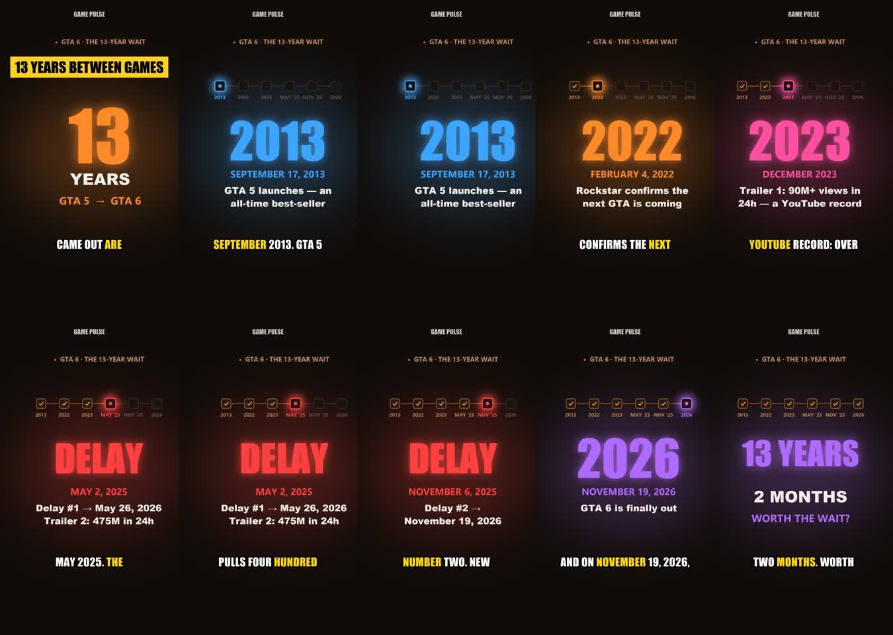

# 1. Game news video factory (GAME PULSE)

**Problem.** A gaming news channel lives on speed: a story is worth the most in its first 48 hours. Doing script, voice-over, editing, captions, thumbnails and metadata by hand takes hours per video.

**Result.** One JSON brief → a finished Short in ~3–4 minutes of rendering, or an 8–9 minute long video in ~40 minutes. **49 videos were rendered in the first 4 days** of the GTA 6 launch (Nov 2026), and 20 of them are published or scheduled on the channel.



## How it works

```
brief (JSON: hook, segments, facts with source URLs, metadata)
  → narration: edge-tts, timing measured from decoded WAV
  → visuals: animated infographic cards (Pillow) or Ken Burns on press-kit stills / official trailer fragments
  → word-level captions (libass), hook plate, watermark, safe areas clear of the Shorts UI
  → procedural music + whooshes (own generator, no Content ID), ducked under the voice
  → loudnorm to −14 LUFS, H.264 encode
  → qa_check.py: format, length vs title promise, loudness, banned words, every source URL opens, frame sheet
  → independent critic agent: facts, policy, defamation risk, hook
  → chapters, thumbnails, titles/descriptions/tags → browser automation schedules the upload
```

## Files

| File | Role |
|---|---|
| `src/make_news_video.py` | Core renderer: TTS, segment timing, stills animation, captions, mix |
| `src/make_infographic_cards.py` | Spec → glowing timeline/number cards → video (centred layout for Shorts) |
| `src/make_music.py` | Procedural background music and SFX; 80-second loop for long videos to stay within memory |
| `src/make_clip_video.py` | Video-clip variant: official footage fragments, chapter cards, disclaimer line |
| `src/make_chapter_cards.py` | 1920×1080 chapter title cards for long videos |
| `src/qa_check.py` | Automated QA gate; writes a report and a frame contact sheet |
| `src/render_batch.py` | Renders a list of jobs in background workers |
| `src/storyboard.py` | Contact sheets of source footage for picking timecodes |
| `src/make_branding.py` | Channel banner, avatar, thumbnails |
| `src/build_trend_plan.py` | Chapters from timing files, upload plan, metadata document |
| `src/yt_studio_scripts.py`, `src/yt_gp_helpers.js` | Generate YouTube Studio upload/scheduling scripts for the browser |
| `src/GP_I01_13_year_wait.json` | Example brief for the infographic Short shown above |

## Lessons that are now built into the code

- TTS durations measured from mp3 headers drift; measuring from decoded audio fixed caption sync.
- A whole-length FFT music filter killed long renders silently at ~9 minutes; a looped bed cut peak memory to ~2 GB.
- The critic agent caught a real problem in every batch (a claim the source did not support, "many" where the source said "some", a defamation-prone framing), so it is now a required step before upload.
- YouTube's upload limit for unverified channels is a rolling 24 hours, not a calendar day; slots are reserved in a status file so scheduled runs do not collide.


