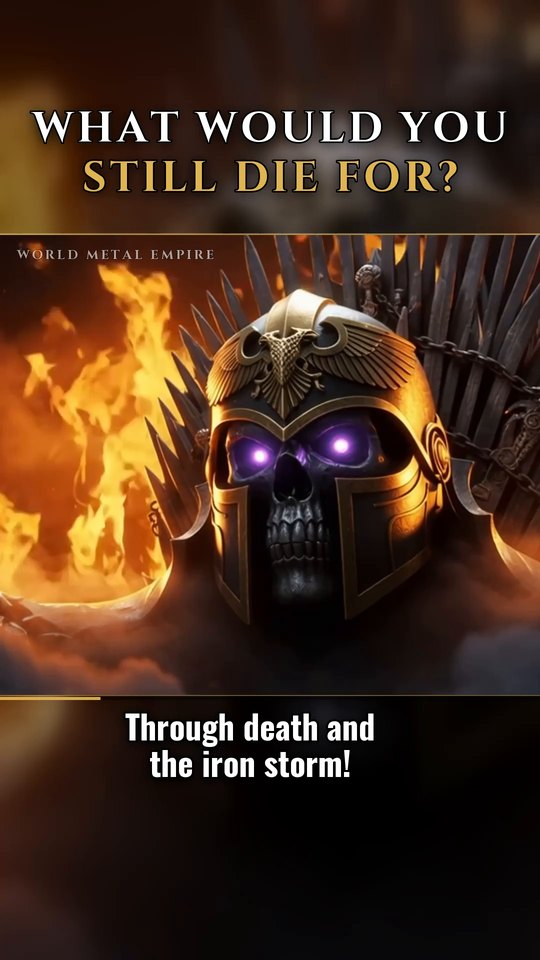
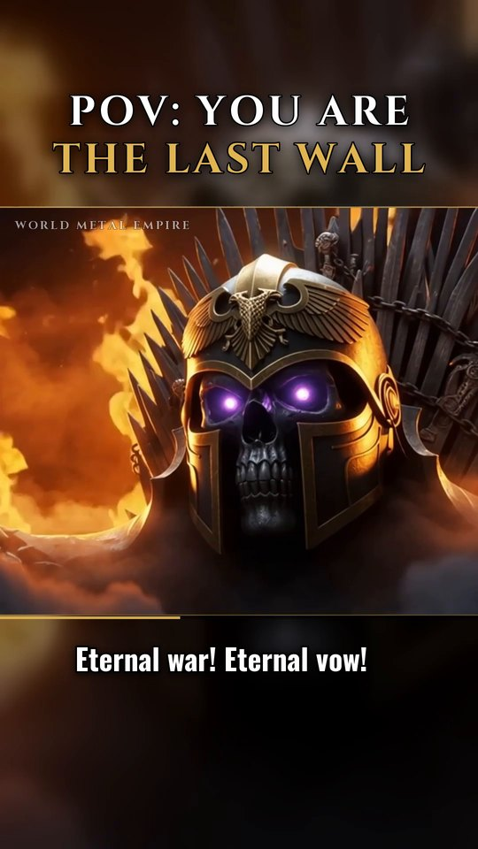

# 2. Music lyric Shorts (World Metal Empire)

**Problem.** An AI-music channel needs a steady stream of Shorts, and lyric Shorts perform best, but timing every sung line by hand for 30 clips is days of work. The timecodes in the track descriptions turned out to be guesses (the first chorus of one track is at 1:34, not 1:15), so they could not be used.

**Result.** **30 lyric Shorts** produced in one pass and scheduled at 3 a day, each about 20 seconds to render. The words on screen match what is actually sung, and this is checked automatically on the rendered output.

## How it works

1. **Hear the track.** `lyric_map.py` transcribes each track in overlapping 2.5-second windows (1.25 s step). The job can be resumed if interrupted.
2. **Align lyrics to audio.** `align_lyrics.py` matches the written lyric lines to the heard windows with monotonic dynamic programming, so every line gets a start and end time. Uncertain lines are flagged for review.
3. **Plan.** `plan_shorts_v2.py` picks a section per Short (chorus, bridge, finale), a hook line and a per-artwork crop.
4. **Render.** `render_shorts_v2.py`: blurred background, slow zoom on the album art, hook text at the top, synced lyric lines below the art (clear of the Shorts buttons), progress bar, a "FULL SONG ↓" call to action, two-pass loudnorm to −14 LUFS.
5. **Verify.** A frame contact sheet, plus a 2.3-second transcription at several line starts of the *output*: the heard words must be that line.
6. **Publish.** `make_shorts_meta_v2.py` writes titles, descriptions (with AI disclosure), pinned comments and the schedule; `make_studio_*` scripts generate the browser upload steps; `wme_timecodes_plan.py` + `make_timecodes_js.py` write measured chapter timecodes into the full-track videos.

## A finding worth noting

The AI singer did not always sing the prompt: where the prompt had typos, it sang different real words ("Blood for the Style"). Aligning against the written lyrics alone would have shown wrong text on screen; the verification step catches this, and the line is set from what was heard.
