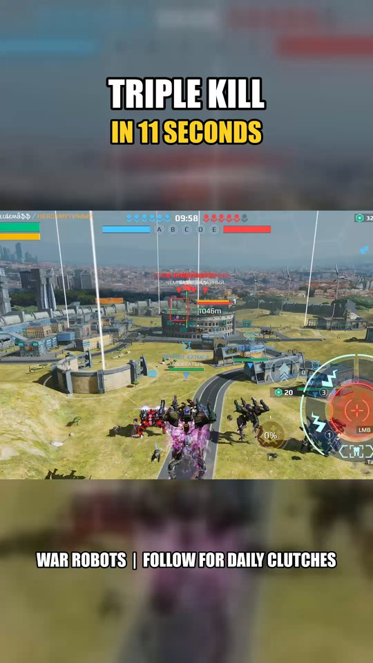
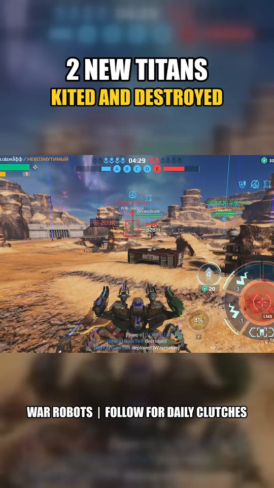

# 3. Gameplay highlight Shorts (War Robots)

**Problem.** Hours of my own match recordings contain a few seconds worth posting. Scrubbing through them by eye does not scale.

**Result.** Highlights are found automatically and rendered as vertical Shorts with a hook in the first 2 seconds; longer compilations go into an editable CapCut project. **19 videos** produced so far (Shorts and a TOP-10 compilation).

## How it works

| Step | File | What it does |
|---|---|---|
| Find peaks | `src/find_highlights.py` | Scores sliding windows by loudness and density of sound spikes (explosions, kill sounds), skips intros and outros, returns the top N windows |
| Render Shorts | `src/render_shorts.py` | 1080×1920: blurred background, centred gameplay, two-line hook, bottom call to action, −14 LUFS |
| Cut segments | `src/cut_segments.py` | Labelled 1920×1080 parts for a compilation |
| CapCut project | `src/clone_capcut_draft.py` | Builds a CapCut desktop project from those parts for final manual polish |

## Engineering notes

- CapCut silently ignores projects generated from scratch. Cloning a project that CapCut has already opened, and swapping in the media, works reliably.
- The bundled ffmpeg is an LGPL build without libx264, so encoding goes through Windows Media Foundation (`h264_mf`), and the blur and colour filters were rewritten for the filters it does have.
