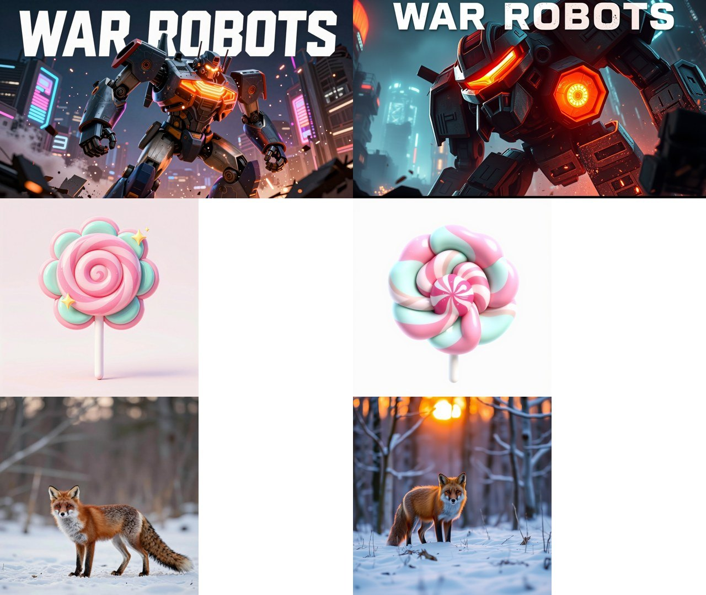

# 3. Local image generation (ComfyUI)

**Problem.** Covers, thumbnails, icons and game art in volume. Paid image APIs add up, and many open models have licences that forbid commercial use.

**Result.** A one-command generator on a consumer GPU (RTX 3060 Ti, 8 GB): a 1024×1024 image in 15–25 seconds, at zero cost per image, using only **Apache-2.0** models (commercial use allowed). **155 images** generated so far for the channels and the game.



## How it works

- `src/gen.py` takes a prompt or a batch file and returns PNGs:
  ```
  gen.py "<prompt>" --preset cover            # 1280×720
  gen.py "<prompt>" --preset square --n 4     # 4 variants
  gen.py --jobs covers.json                   # a whole series
  gen.py --status | --start | --stop | --free
  ```
  Presets: cover, square, shorts (864×1536, then upscaled), wide, portrait.
- Two models: **Z-Image-Turbo** (8 steps; handles text on images well) and **FLUX.1 schnell** (4 steps; a second style).
- Every image is logged with prompt, seed, model, licence and time, so a commercial asset can always be traced to a licence.
- `src/server_launch.py` starts the ComfyUI server hidden through Windows Task Scheduler. Paid cloud nodes are disabled, so a script cannot spend money by mistake.
- The same server is exposed to AI agents through the official ComfyUI MCP server, so an agent can generate assets inside a larger task.
- `src/*_api.json` are the API workflows the generator fills in.

## Engineering notes

- On 8 GB of VRAM, with about 3.5 GB taken by other apps, weights stream from system RAM. A smaller FP4 text encoder is a drop-in fallback with practically the same quality (compared side by side).
- Running the text encoder on CPU was measured at 3–5× slower and rejected.
- Exact text and logos are overlaid with Pillow afterwards; diffusion text is used only for stylised titles.
