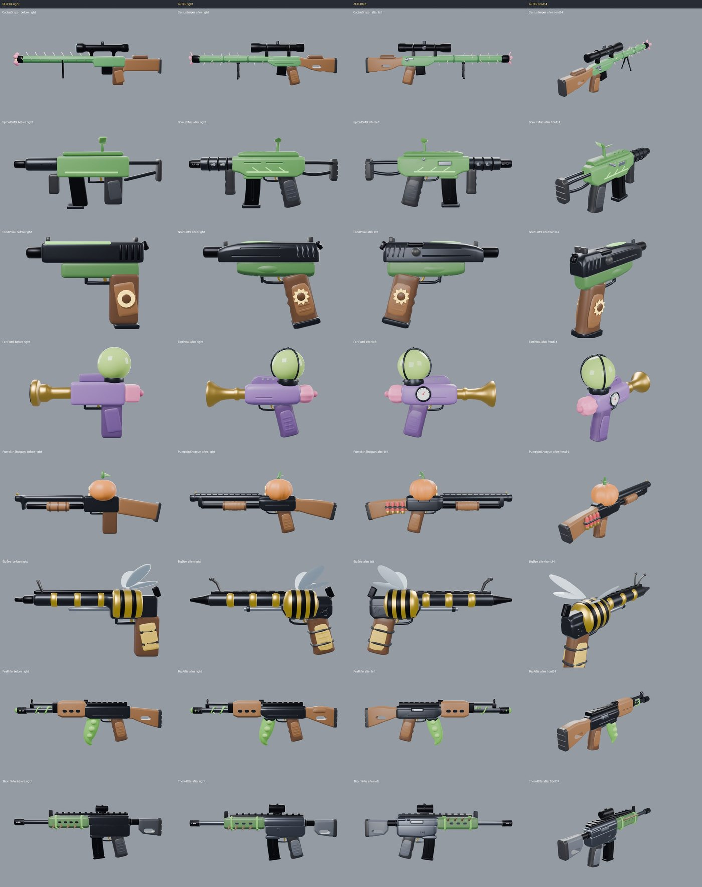
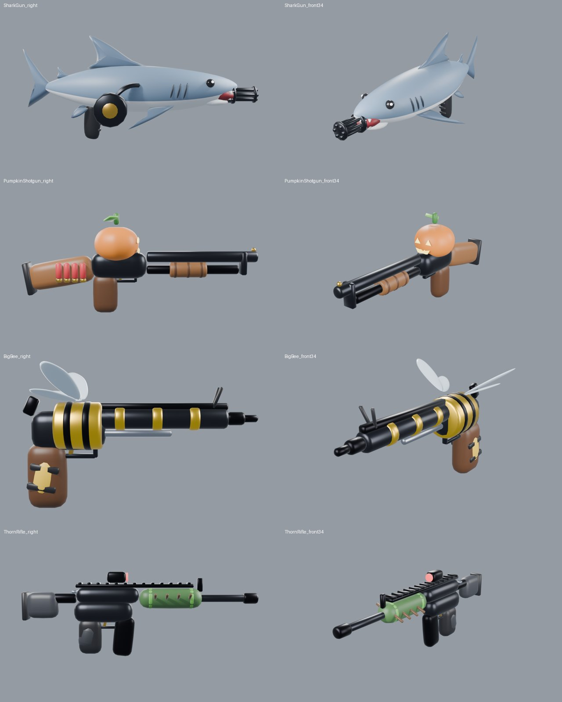
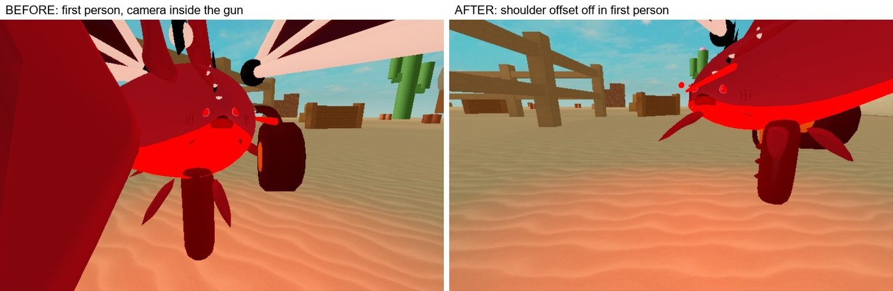
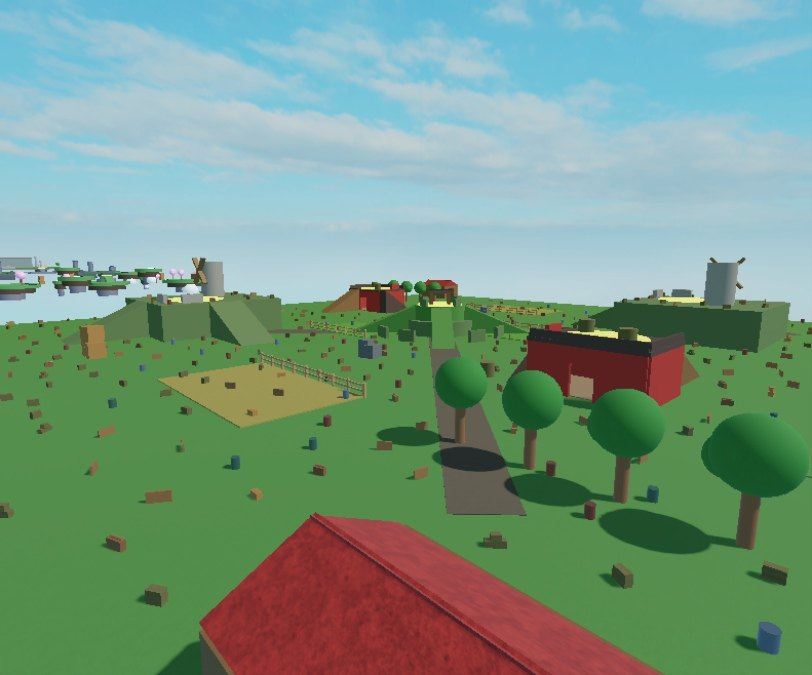

# 4. Blender → Roblox 3D pipeline (Sugar Bloom)

**Problem.** A Roblox shooter needs a whole arsenal: 17 weapons, each with rarity skins, stylised, light enough for phones (≤ 6,000 triangles), and consistent in style. Buying or hand-modelling all of it was out of budget.

**Result.** Every weapon is described in Python and built in Blender through its Python API, run by an AI agent over the official Blender MCP server, rendered from four angles for review, exported and imported into Roblox Studio. **17 weapons, 85 skin kits, 20 arenas**; the game's self-test suite passes **86/86** in Studio, plus **41** offline logic checks.

## How it works

| Step | File | What it does |
|---|---|---|
| Model | `src/build_weapons.py` | Runs inside Blender (via the Blender MCP server): builds each weapon in Roblox coordinates, one mesh piece per colour/material group so in-game skin recolouring keeps working, records bounding boxes, exports glTF at 1 m = 1 stud |
| Hero passes | `src/hero_rifles.py`, `src/hero_guns2.py`, `src/hero_small.py` | Hand-tuned toy hard-surface silhouettes for the 9 most visible weapons: chamfered lofts, boolean cut-outs (vents, ports, grooves), ribbed grips; same handle, muzzle and overall box, so existing skin attachments stay in place |
| Skins | `src/build_kit_shapes.py` | Replaces skin details that used to be stacks of primitive parts (spikes, rings, horns, vines, runes) with one smooth mesh each, normalised to a unit box |
| Review | `src/render_preview.py` | Four-angle renders and before/after sheets for every change |
| Hand-off | `src/make_manifest.py`, `src/apply_studio_ids.py` | Manifest of meshes and writing the Roblox asset IDs back into the game code |

## In the game

The game itself (Luau, about 18,000 lines, built with Rojo) is a farming game with an arena shooter: 20 arenas, 4 modes, economy simulated before balancing, first-person weapon view. Its source is not published here; the renders below are from Roblox Studio.

## Engineering notes

- Skin details must sit on the surface: a ray-voting inside/outside test replaced a nearest-face normal test that gave false results on thin petals and leaves.
- Details are checked in the plane they are seen from (blade width for a sword guard), otherwise they disappear from the side.
- Game-economy numbers (drop chances, unlock gates, skin bonuses) are run through a simulation first, then written into code.
